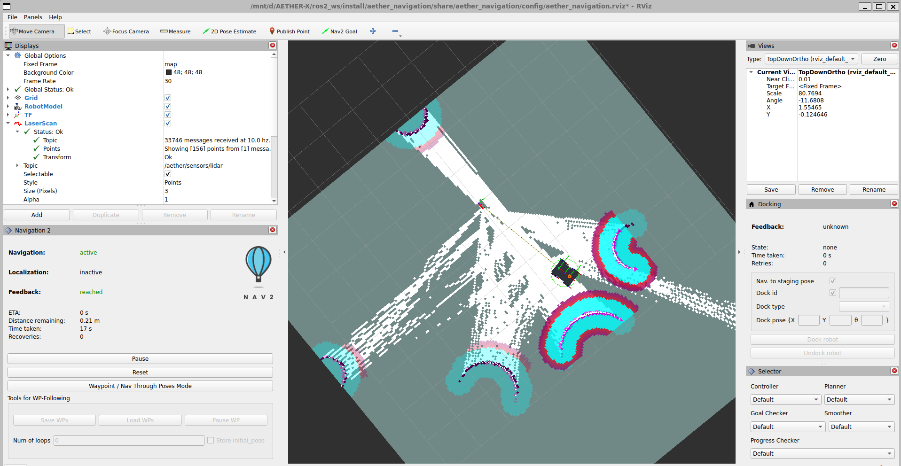
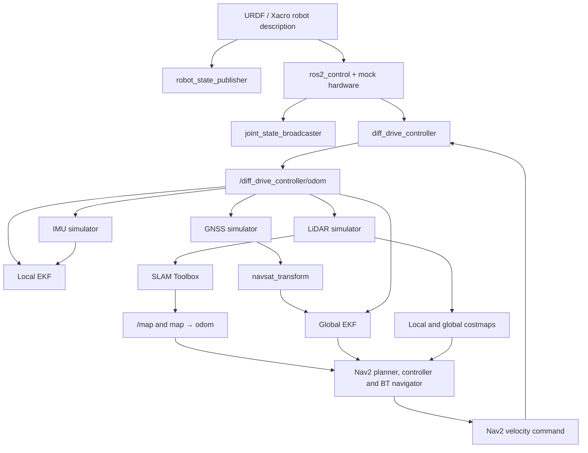

# AETHER-X — Simulation-First Autonomous Robotics Platform

<p align="center">
  <strong>ROS 2 Jazzy · C++17 · ros2_control · robot_localization · SLAM Toolbox · Nav2</strong>
</p>

<p align="center">
  <a href="https://github.com/DHANUSRI21/AETHER-X/actions/workflows/ci.yml">
    
  </a>
  
  
  
  
</p>

**AETHER-X is a modular ROS 2 autonomous mobile-robot software platform** that integrates robot modelling, simulated sensing, differential-drive control, state estimation, 2D mapping and autonomous navigation in one reproducible workspace.

The project brings together seven ROS 2 packages and a connected data path from wheel odometry and simulated sensors to localization, SLAM, Nav2 path planning, velocity control and goal execution. It is an engineering and validation platform for embedded robotics concepts—not a claim of physical-robot deployment.

<p align="center">
  
</p>
<p align="center"><em>RViz visualization evidence: robot model, LiDAR display and navigation costmap configuration.</em></p>

---

## Project at a glance

| Area | Implementation |
|---|---|
| Middleware | ROS 2 Jazzy |
| Primary implementation | C++17 |
| Robot model | URDF / Xacro |
| Hardware abstraction | ros2_control with `mock_components/GenericSystem` |
| Motion control | Four-wheel differential-drive controller |
| Simulated sensors | IMU, GNSS and 360-beam LiDAR |
| State estimation | robot_localization EKF and navsat_transform |
| Mapping | SLAM Toolbox |
| Autonomous navigation | Nav2, NavFn planner and Regulated Pure Pursuit |
| Visualization | RViz2 and Nav2 RViz plugins |
| Build system | CMake, ament_cmake and colcon |
| Testing and CI | GoogleTest, ament lint tools and GitHub Actions |

### Verified engineering results

- **7/7 ROS 2 packages** built in the full workspace.
- **86 reported tests, 0 failures and 0 errors** in the recorded full-workspace validation; 8 tests were skipped and are disclosed below.
- GitHub Actions CI successfully installed ROS 2 Jazzy, installed workspace dependencies, built all seven packages and ran the complete test suite.
- Sensor stream measurements in the WSL2 runtime: IMU approximately **100 Hz**, GNSS **10 Hz**, LiDAR **10 Hz**.
- A recorded Nav2 `ComputePathToPose` request succeeded, followed by a successful `NavigateToPose` execution and zero-velocity verification.

### Engineering highlights

- **End-to-end ROS 2 integration:** connected robot description, ros2_control, simulated sensors, state estimation, SLAM and Nav2 through ROS topics, transforms, lifecycle nodes and actions.
- **Motion-aware sensor simulation:** IMU, GNSS and LiDAR nodes use wheel odometry to produce sensor streams that respond to simulated robot movement.
- **Explicit transform ownership:** separated controller odometry and SLAM map transforms to avoid competing TF publishers.
- **Observable validation:** checked measured sensor rates, controller states, lifecycle activation, path-planning results, navigation feedback and final zero-velocity output.
- **Repeatable CI:** automated dependency installation, full-workspace build and complete test execution on GitHub Actions.

---

## System architecture

The architecture separates robot description, control, system monitoring, sensing, localization/mapping and navigation into focused packages.



### Transform ownership

To avoid competing transform publishers:

- `diff_drive_controller` publishes **`odom → base_footprint`**.
- SLAM Toolbox publishes **`map → odom`**.
- The global EKF is configured with `publish_tf: false`.

### ROS 2 package layout

| Package | Responsibility |
|---|---|
| `aether_core` | Core status publisher and heartbeat/state monitor. The monitor tracks system state using the core status heartbeat. |
| `aether_description` | Robot URDF/Xacro, chassis and sensor frames, wheel joints, ros2_control mock-hardware description and robot visualization assets. |
| `aether_control` | Controller-manager configuration, joint-state broadcaster and differential-drive controller launch. |
| `aether_sensors` | Motion-aware simulated IMU, GNSS and LiDAR publishers driven by wheel odometry. |
| `aether_localization` | Local/global robot_localization EKFs, GNSS transformation and SLAM Toolbox configuration/launch. |
| `aether_navigation` | Nav2 planner, controller, smoother, behavior server, BT navigator, lifecycle manager, costmaps and RViz configuration. |
| `aether_bringup` | Main launch entry point that composes robot description/control, core nodes and sensor simulators, with optional RViz startup. |

---

## Software and tools used

The list distinguishes the project implementation stack from the engineering tools used to build, test and automate it.

| Software / tool | How it is used |
|---|---|
| **Ubuntu 24.04** | Development and CI operating-system environment. Local runtime validation was performed in WSL2. |
| **ROS 2 Jazzy** | Robot middleware, nodes, topics, services, actions, parameters, launch and lifecycle management. |
| **C++17** | Core heartbeat/monitor and IMU, GNSS and LiDAR simulator implementations. |
| **Python 3** | ROS 2 Python launch descriptions and launch-time orchestration. |
| **CMake** | Native C++ and ROS 2 package build configuration. |
| **ament_cmake** | ROS 2 package build and test integration. |
| **colcon** | Multi-package workspace build and test orchestration. |
| **rosdep** | Resolving and installing dependencies declared by ROS 2 packages. |
| **rclcpp** | C++ ROS 2 nodes, publishers, subscriptions, timers and parameters. |
| **sensor_msgs / nav_msgs / geometry_msgs** | IMU, GNSS, LaserScan, odometry and motion-command message interfaces. |
| **URDF / Xacro** | Parameterized robot geometry, links, joints, sensor frames and control interfaces. |
| **robot_state_publisher** | Publishing robot link transforms from the robot description and joint states. |
| **ros2_control** | Controller manager and hardware abstraction for the differential-drive system. |
| **mock_components/GenericSystem** | Simulated ros2_control hardware interface; no physical actuators are connected. |
| **diff_drive_controller** | Wheel command handling and differential-drive odometry. |
| **joint_state_broadcaster** | Publishing the four simulated wheel-joint states. |
| **robot_localization** | Local and global EKF state estimation. |
| **navsat_transform_node** | Converting simulated GNSS data into a local Cartesian odometry input. |
| **SLAM Toolbox** | 2D LiDAR-based mapping, map publication and the map-to-odometry transform. |
| **Nav2** | Autonomous navigation framework, action servers, behavior tree navigation and lifecycle management. |
| **NavFn Planner** | Grid-based global path planning using the Nav2 planner server. |
| **Regulated Pure Pursuit** | Path-following controller with velocity regulation and collision-checking configuration. |
| **Nav2 costmap_2d** | LiDAR-backed local and global obstacle/inflation costmaps. |
| **RViz2 + Nav2 RViz plugins** | Robot, TF, map, scan, costmap, path and navigation-goal visualization. |
| **GoogleTest** | C++ unit testing for the core state manager. |
| **ament_lint_auto / ament_lint_common** | ROS package lint-test integration. |
| **flake8 / pep257 / xmllint / lint_cmake** | Python, documentation, XML and CMake quality checks. |
| **cppcheck / cpplint / uncrustify** | C++ static-analysis, lint and formatting checks where configured. |
| **Git / GitHub** | Source control, project hosting and collaboration. |
| **GitHub Actions** | Automated ROS 2 Jazzy dependency installation, full-workspace build and test pipeline. |

---

## Implemented subsystems

### 1. Robot model and control

The Xacro robot model defines a compact four-wheel platform with a base frame, wheel joints and dedicated IMU, GNSS and LiDAR frames.

| Parameter | Configured value |
|---|---:|
| Chassis length | 0.60 m |
| Chassis width | 0.40 m |
| Chassis height | 0.15 m |
| Modelled base mass | 5.0 kg |
| Wheel radius | 0.08 m |
| Wheel separation | 0.44 m |
| Wheel joints | 4 |

The control stack uses `controller_manager`, `joint_state_broadcaster` and `diff_drive_controller`. The controller is configured with a 100 Hz controller-manager update rate and 50 Hz odometry publication rate.

### 2. Motion-aware sensor simulation

The sensor nodes consume differential-drive odometry so their output responds to simulated robot motion.

| Sensor | ROS topic | Rate | Implementation |
|---|---|---:|---|
| IMU | `/aether/sensors/imu` | 100 Hz | Simulated inertial data with configurable deterministic noise and odometry-driven angular motion. |
| GNSS | `/aether/sensors/gnss` | 10 Hz | Simulated position/fix stream with configurable reference and noise; odometry is used for motion response. |
| LiDAR | `/aether/sensors/lidar` | 10 Hz | 360-beam planar scan, 1° angular resolution, configured range 0.12–30 m, with simulated noise and world-fixed circular obstacles. |

These are **software-generated sensor streams**, not recordings from physical IMU, GNSS or LiDAR devices.

### 3. Localization and mapping

- Local 2D EKF configured at 30 Hz, using wheel odometry and IMU yaw-rate input.
- GNSS transformation through `navsat_transform_node`.
- Global EKF combines wheel odometry, transformed GNSS odometry and IMU yaw rate.
- SLAM Toolbox runs in mapping mode and consumes the simulated LiDAR scan.
- Configured map resolution: **0.05 m/cell**.

In the recorded runtime snapshot, SLAM published a **215 × 194-cell** map at 0.05 m resolution. This is a snapshot of the map at that test point—not a claim of complete environment coverage or certified mapping accuracy.

### 4. Autonomous navigation

The Nav2 configuration includes:

- **Planner:** NavFn grid-based planner with A* enabled and unknown-space traversal disabled.
- **Controller:** Regulated Pure Pursuit path follower.
- **Smoother:** Simple smoother.
- **Behaviors:** Spin, backup, drive-on-heading and wait.
- **Navigation orchestration:** Behavior Tree Navigator and lifecycle manager.
- **Obstacle processing:** LiDAR observation source in local and global costmaps, with inflation layers.

The controller is configured for a conservative desired linear velocity of 0.15 m/s. Nav2 velocity commands are remapped to `/diff_drive_controller/cmd_vel`.

---

## Build and run

### Prerequisites

- Ubuntu 24.04 with ROS 2 Jazzy installed.
- ROS 2 development tools, including `rosdep` and `colcon`.
- A graphical environment capable of running RViz2. For WSL2, WSLg or a configured X server is required for GUI visualization.

### 1. Clone the repository

```bash
cd /mnt/d
git clone https://github.com/DHANUSRI21/AETHER-X.git
cd /mnt/d/AETHER-X/ros2_ws
```

### 2. Install workspace dependencies

```bash
source /opt/ros/jazzy/setup.bash

# Initialize rosdep once per machine, if not already initialized:
sudo rosdep init
rosdep update

rosdep install --from-paths src --ignore-src --rosdistro jazzy -r -y
```

If rosdep has already been initialized on the machine, skip `sudo rosdep init`.

### 3. Build all seven packages

```bash
cd /mnt/d/AETHER-X/ros2_ws
source /opt/ros/jazzy/setup.bash

colcon build

source install/setup.bash
```

For the WSL2 checkout used during project validation, the workspace path was `/mnt/d/AETHER-X/ros2_ws`. Use your actual clone location if it differs.

### 4. Start the base robot

**Terminal 1 — Base bringup**

```bash
cd /mnt/d/AETHER-X/ros2_ws
source /opt/ros/jazzy/setup.bash
source install/setup.bash

ros2 launch aether_bringup bringup.launch.py
```

Wait for the controller spawners to report that both controllers are configured and active.

### 5. Start localization and SLAM

**Terminal 2 — Localization launch**

```bash
cd /mnt/d/AETHER-X/ros2_ws
source /opt/ros/jazzy/setup.bash
source install/setup.bash

ros2 launch aether_localization localization.launch.py
```

**Terminal 3 — Configure and activate SLAM**

```bash
source /opt/ros/jazzy/setup.bash
source /mnt/d/AETHER-X/ros2_ws/install/setup.bash

ros2 lifecycle set /slam_toolbox configure
ros2 lifecycle set /slam_toolbox activate
ros2 lifecycle get /slam_toolbox
```

Expected final lifecycle state: `active [3]`.

### 6. Start Nav2

**Terminal 4 — Navigation**

```bash
cd /mnt/d/AETHER-X/ros2_ws
source /opt/ros/jazzy/setup.bash
source install/setup.bash

ros2 launch aether_navigation navigation.launch.py
```

The configured lifecycle manager autostarts the Nav2 servers.

### 7. Open RViz2

**Terminal 5 — Visualization**

```bash
source /opt/ros/jazzy/setup.bash
source /mnt/d/AETHER-X/ros2_ws/install/setup.bash

rviz2 -d /mnt/d/AETHER-X/ros2_ws/src/aether_navigation/config/aether_navigation.rviz
```

Use the `map` fixed frame. The project RViz configuration includes the robot model, TF, LiDAR scan, map, costmaps and Nav2 goal tools.

### 8. Send a navigation goal

Before sending a goal, confirm that Nav2 is active and the goal lies in mapped, traversable space.

**Terminal 6 — Goal execution**

```bash
source /opt/ros/jazzy/setup.bash
source /mnt/d/AETHER-X/ros2_ws/install/setup.bash

ros2 action send_goal /navigate_to_pose \
  nav2_msgs/action/NavigateToPose \
  "{pose: {header: {frame_id: map}, pose: {position: {x: 0.99, y: 0.50, z: 0.0}, orientation: {x: 0.0, y: 0.0, z: 0.0, w: 1.0}}}, behavior_tree: ''}" \
  --feedback
```

The goal `(0.99, 0.50)` in the `map` frame is the goal used in the recorded runtime validation. Results can vary with the live map and robot start state.

You can also use the **Nav2 Goal** tool in RViz: click a free, mapped point and drag to set the desired heading.

### 9. Verify the robot stopped

```bash
ros2 topic echo /diff_drive_controller/odom --once
ros2 topic echo /diff_drive_controller/cmd_vel_out --once
```

After a completed goal, check that the odometry twist and controller output are approximately zero.

### Shutdown

Stop the launch terminals with `Ctrl+C` in reverse order: RViz, Nav2, localization/SLAM, then base bringup. Start each launch only once; duplicate controller-manager or sensor nodes can make the ROS graph ambiguous.

---

## Validation and CI

### Recorded local runtime validation

| Validation | Recorded result |
|---|---|
| Full workspace build | 7 packages finished |
| Full workspace tests | 86 tests, 0 errors, 0 failures, 8 skipped |
| Base bringup | One instance of each base node; both controllers active |
| Wheel state | Four wheel joints in `/joint_states` |
| IMU publication | Approximately 100 Hz |
| GNSS publication | Approximately 10 Hz |
| LiDAR publication | Approximately 10 Hz |
| Localization | Local/global EKF and GNSS odometry topics available |
| SLAM | Lifecycle active; `/map` published at 0.05 m resolution |
| Nav2 | Planner, controller, BT navigator, behavior and smoother servers active |
| Path planning | `ComputePathToPose` succeeded |
| Goal execution | `NavigateToPose` succeeded with 0 recoveries |
| Stop verification | Odometry twist effectively zero; controller output exactly zero |

For the recorded goal `(0.99, 0.50)`, the reported final pose was approximately `(0.8347, 0.3790)`. The calculated straight-line position error was approximately **0.197 m**, within the configured 0.20 m XY goal tolerance. The navigation action reported `SUCCEEDED` and zero recoveries.

An earlier simulation run also demonstrated a successful route around a **static simulated obstacle** to a goal near `(4.3, -1.3)`, with the navigation action succeeding and zero recoveries. The separate dynamic-obstacle injection experiment showed costmap response but did not demonstrate successful dynamic replanning (see limitations).

### GitHub Actions

The repository includes a GitHub Actions workflow at `.github/workflows/ci.yml`. It:

1. Sets up Ubuntu 24.04 and ROS 2 Jazzy.
2. Installs the pinned ROS APT source package and verifies its SHA-256 checksum.
3. Installs ROS workspace dependencies with rosdep.
4. Builds the complete colcon workspace.
5. Runs the complete test and lint suite.

**Recorded successful CI run:** [AETHER-X CI — Run #6](https://github.com/DHANUSRI21/AETHER-X/actions/runs/43644060244)

The successful run completed the dependency-installation, full-workspace build and test steps. The recorded summary was 7 packages built and 86 tests with 0 failures and 0 errors; 8 were skipped.

### Run tests locally

```bash
cd /mnt/d/AETHER-X/ros2_ws
source /opt/ros/jazzy/setup.bash

colcon test
colcon test-result --verbose
```

---

## Known limitations and engineering boundaries

AETHER-X is a **simulation-validated software prototype**. The following boundaries are important:

1. **Mock hardware, not physical hardware:** The ros2_control system uses `mock_components/GenericSystem`. No physical robot, motor driver or sensor hardware has been tested.
2. **No hard real-time claim:** The recorded WSL2 environment did not permit FIFO real-time scheduling for the controller manager. The configured update frequency is not a hard real-time guarantee.
3. **Dynamic-obstacle replanning is not yet validated:** Runtime obstacle injection affected the costmaps, but a successful alternate-path replanning test while moving has not been demonstrated.
4. **Mapping coverage is bounded by the recorded run:** A published map and its resolution do not by themselves establish complete environment coverage or localization accuracy.
5. **Skipped checks are disclosed:** The local release-validation record contains 8 skipped tests associated with a cppcheck 2.13.0 performance issue. They are not reported as failures, but they should not be described as executed and passed.

Earlier simulation testing demonstrated a successful route around a **static simulated obstacle**. That result should not be generalized into a claim of robust dynamic-obstacle avoidance.

---

## Repository structure

```text
AETHER-X/
├── .github/
│   └── workflows/
│       └── ci.yml
├── maps/
│   ├── aether_environment.pgm
│   └── aether_environment.yaml
└── ros2_ws/
    ├── src/
    │   ├── aether_core/
    │   ├── aether_description/
    │   ├── aether_control/
    │   ├── aether_sensors/
    │   ├── aether_localization/
    │   ├── aether_navigation/
    │   └── aether_bringup/
    ├── docs/
    │   └── release/
    └── evidence/
        └── release_20261115/
```

---

## Engineering focus

AETHER-X is intended to demonstrate integration engineering across ROS 2 middleware, C++ node development, robot modelling, control interfaces, sensor-data pipelines, state estimation, SLAM, autonomous navigation, testing and continuous integration.

The central engineering objective is to keep interfaces and responsibilities modular, make the integrated stack reproducible, and validate system behavior with observable ROS topics, actions, lifecycle transitions, test results and runtime evidence.

---

## Repository

**Source code:** https://github.com/DHANUSRI21/AETHER-X  
**CI pipeline:** https://github.com/DHANUSRI21/AETHER-X/actions  
**Release documentation:** [Runtime validation report](ros2_ws/docs/release/20261115/RUNTIME_VALIDATION_REPORT.md) · [Architecture overview](ros2_ws/docs/release/20261115/ARCHITECTURE_OVERVIEW.md) · [Known limitations](ros2_ws/docs/release/20261115/KNOWN_LIMITATIONS.md)

<p align="center">
  <sub>Built with ROS 2 Jazzy · C++17 · Open-source robotics tools</sub>
</p>
