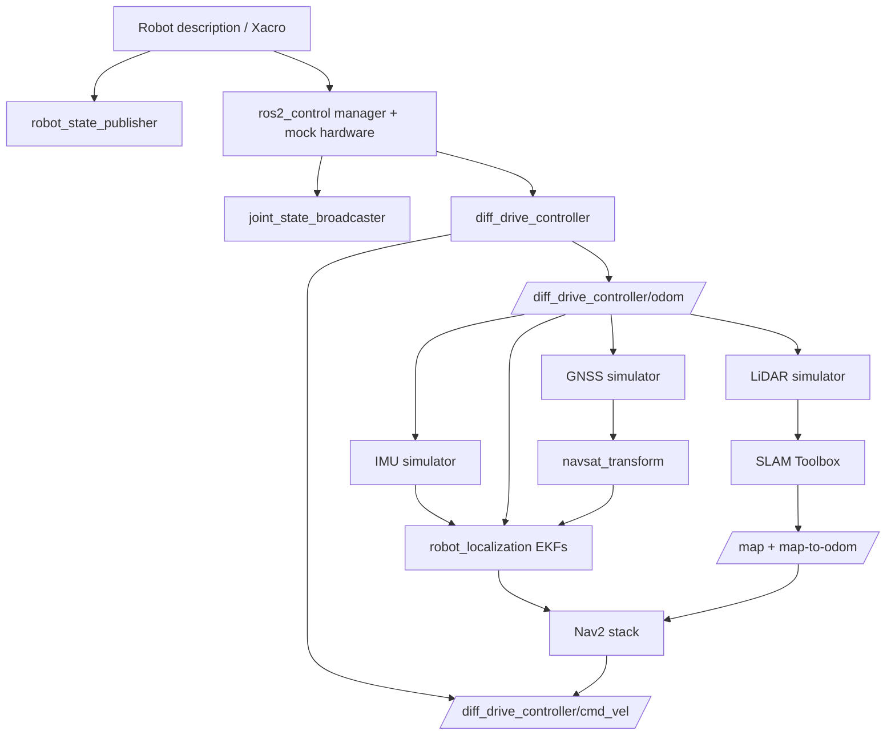

# AETHER-X — Runtime Validation Report

**Validation snapshot:** 15 November 2026
**Platform:** Ubuntu 24.04 on WSL2, ROS 2 Jazzy
**Workspace:** `/mnt/d/AETHER-X/ros2_ws`
**Hardware interface:** `mock_components/GenericSystem` (simulation only)
**Status:** Build, tests, and the recorded base-to-navigation runtime smoke test passed.

## 1. Executive summary

AETHER-X is a ROS 2-based, simulation-first mobile robot stack. The latest recorded validation sequence covered compilation, automated tests, single-instance bringup, controller activation, simulated sensor streaming, localization, SLAM map publication, Nav2 lifecycle activation, path planning, goal execution, and zero-velocity confirmation.

The results support a **simulation-validated software prototype**. They do not establish physical-robot readiness, hard real-time performance, or successful dynamic-obstacle replanning.

## 2. Build and automated tests

| Check | Result |
|---|---:|
| Workspace packages built | 7 / 7 |
| Workspace packages tested | 7 / 7 |
| Reported tests | 86 |
| Errors | 0 |
| Failures | 0 |
| Skipped | 8 |

The recorded commands were:

```bash
cd /mnt/d/AETHER-X/ros2_ws
source /opt/ros/jazzy/setup.bash
colcon build
source install/setup.bash
colcon test
colcon test-result --verbose
```

The eight skipped tests were not identified in the captured summary. Before publishing a formal release, inspect the individual test-result XML files and record why each test is skipped.

## 3. Architecture summary

The workspace contains seven ROS 2 packages:

| Package | Responsibility |
|---|---|
| `aether_core` | Core status publisher and heartbeat/state monitor |
| `aether_description` | Robot URDF/Xacro, frames, ros2_control mock hardware description, RViz model configuration |
| `aether_control` | ros2_control configuration, joint-state broadcaster, differential-drive controller |
| `aether_sensors` | Simulated IMU, GNSS, and LiDAR publishers |
| `aether_localization` | robot_localization EKFs, GNSS transform, SLAM Toolbox launch/configuration |
| `aether_navigation` | Nav2 planner, controller, behavior tree navigator, costmaps, navigation configuration |
| `aether_bringup` | Main bringup composition for description/control/core/sensors, optional RViz |

### Data and transform flow



The controller owns `odom -> base_footprint`. SLAM Toolbox publishes the `map -> odom` transform. The global EKF is configured not to publish a competing transform.

## 4. Runtime smoke-test results

### 4.1 Single-instance base bringup

After stopping earlier launch sessions, a clean `aether_bringup` run showed one instance each of the base nodes, including `/controller_manager`, `/aether_monitor`, the sensor simulators, and `robot_state_publisher`.

Both controllers were reported `active`:

- `joint_state_broadcaster`
- `diff_drive_controller`

`/joint_states` contained all four wheel joints: front-left, rear-left, front-right, and rear-right.

The core status topic published `AETHER-X CORE ONLINE` and the monitor transitioned to `OPERATIONAL`.

### 4.2 Sensor publication rates

| Topic | Measured rate | Configured/expected rate | Result |
|---|---:|---:|---|
| `/aether/sensors/imu` | 100.0 Hz | 100 Hz | Pass |
| `/aether/sensors/gnss` | 10.0 Hz | 10 Hz | Pass |
| `/aether/sensors/lidar` | 10.0 Hz | 10 Hz | Pass |

The GNSS rate command initially emitted a “not published yet” discovery warning, then measured a stable 10 Hz stream.

### 4.3 Localization and SLAM

SLAM Toolbox lifecycle transitions succeeded from `unconfigured` through `configure` and `activate`.

The following topics were available and sampled:

- `/odometry/filtered`
- `/odometry/gps`
- `/odometry/global`
- `/map`
- `/map_metadata`

The sampled map had:

- Resolution: approximately **0.05 m/cell**
- Width: **215 cells**
- Height: **194 cells**
- Frame: `map`

This establishes map publication at the sampled time, not complete coverage of the intended environment.

### 4.4 Nav2 activation and interfaces

The following Nav2 lifecycle nodes were `active`:

- `/planner_server`
- `/controller_server`
- `/bt_navigator`
- `/behavior_server`
- `/smoother_server`

Available actions included:

- `/compute_path_to_pose`
- `/navigate_to_pose`
- `/spin`

Global and local costmap topics were present.

### 4.5 Path planning

A path-only `ComputePathToPose` request to `(x=0.99 m, y=0.50 m)` in `map` returned `SUCCEEDED`, `error_code: 0`, and an empty error message. The observed planning time was approximately **3.03 ms**. This action did not command robot motion.

### 4.6 Navigation execution and stop confirmation

A `NavigateToPose` request to `(0.99 m, 0.50 m)` returned `SUCCEEDED`, with `error_code: 0` and zero recovery behaviours.

Reported final position:

- X: **0.8347 m**
- Y: **0.3790 m**

Euclidean distance from the requested goal, calculated from those reported coordinates, was approximately **0.197 m**. The configured XY goal tolerance was 0.20 m. The action feedback also reported a remaining path distance of approximately 0.211 m; this is a path-distance field and should not be confused with the straight-line position error calculation above.

After the goal completed, the odometry twist was effectively zero (`linear.x` approximately `9.16e-17 m/s`, `angular.z` approximately `-4.44e-16 rad/s`). The controller output message reported exactly `0.0` for all linear and angular components.

This validates a simulated navigation-and-stop sequence using mock ros2_control hardware.

## 5. Earlier simulation evidence — static obstacle avoidance

Earlier recorded AETHER-X testing demonstrated a successful Nav2 route around a static simulated obstacle to a goal near `(4.3 m, -1.3 m)`. The action returned `SUCCEEDED`, with final reported position approximately `(4.182 m, -1.455 m)`, about 0.195 m in straight-line distance from the requested goal, and zero recoveries.

This should be described as **static obstacle circumvention demonstrated in simulation**. It is not evidence of dynamic obstacle detection and successful replanning while moving.

## 6. Dynamic obstacle test — outcome and limitation

A runtime LiDAR parameter was used to inject an additional simulated obstacle. The obstacle became visible to the costmaps; a sampled local-costmap region contained high-cost cells and the corresponding global-costmap cell had a high cost.

A path-planning attempt toward `(5.8 m, -1.5 m)` was aborted with error code `208` and an empty path. The request was in an area where the current map/planner constraints did not provide a valid route. This is evidence that the obstacle/costmap affected planning and that an invalid request was rejected; it is **not** evidence of successful dynamic replanning or obstacle avoidance during motion. The injected obstacle was subsequently disabled.

**Release wording:** “Dynamic obstacle injection and costmap response were tested; successful dynamic-obstacle replanning remains unverified.”

## 7. Known limitations and cautions

1. **Simulation only:** The robot uses `mock_components/GenericSystem`. No physical robot or real sensor hardware validation is claimed.
2. **No hard real-time claim:** WSL2 did not permit FIFO real-time scheduling for the controller manager (`Operation not permitted`).
3. **Command-limit warning:** The controller manager logged that command-limit enforcement was disabled and URDF command limits would be ignored. Treat this as an open configuration item until explicitly corrected and revalidated.
4. **Skipped tests:** Eight tests were skipped in the aggregate result; their individual reasons still need to be recorded.
5. **Map coverage:** The published map dimensions only describe the map at the sampled time. Do not claim complete environment mapping without a coverage/quality assessment.
6. **Dynamic obstacles:** Costmap injection was observed, but successful dynamic replanning while the robot is moving has not been proven.
7. **Initial sensor warnings:** During startup, the sensor simulators briefly reported stale/unavailable odometry until the controller/odometry pipeline came online. The sensor rates were subsequently measured at their target frequencies.

## 8. Evidence file locations

The live runtime snapshot was saved on the workstation at:

`/mnt/d/AETHER-X/evidence/runtime_smoke_20261115/runtime_snapshot.txt`

That file is on the user's Windows D: drive mounted in WSL. It was not available to this artifact-building environment and is therefore **referenced, not embedded**, in this kit. Copy it into this kit's `evidence/` folder or keep it in the workspace evidence folder before sharing the final complete evidence bundle.

The included RViz screenshot is supplementary visualization evidence dated 14 November 2026. It is not a screenshot of the 15 November runtime smoke test.

## 9. Recommended release gates still open

- Review and document all eight skipped tests.
- Resolve or formally justify the `Enforcing command limits is disabled` warning; rebuild and rerun tests/runtime checks afterward.
- Run a dedicated dynamic-obstacle test with a safe, reachable route and capture evidence of replanning while the robot is moving, or explicitly keep this feature outside the validated scope.
- Capture a fresh RViz screenshot from the 15 November clean runtime, showing map, robot, LiDAR, costmaps, and active navigation state.
- Save complete launch logs and test XML results alongside the runtime snapshot.
- Review `git status`, ensure generated build/install/log files are excluded, and create a tagged commit only after the release gates are addressed.

---

**Overall assessment:** AETHER-X has a clean 7-package build and automated test result (86 reported tests, zero errors/failures, eight skipped) and a successful simulation runtime smoke test through Nav2 goal execution and stopping. It is suitable to present as a simulation-validated ROS 2 robotics software prototype, with the limitations above disclosed.
